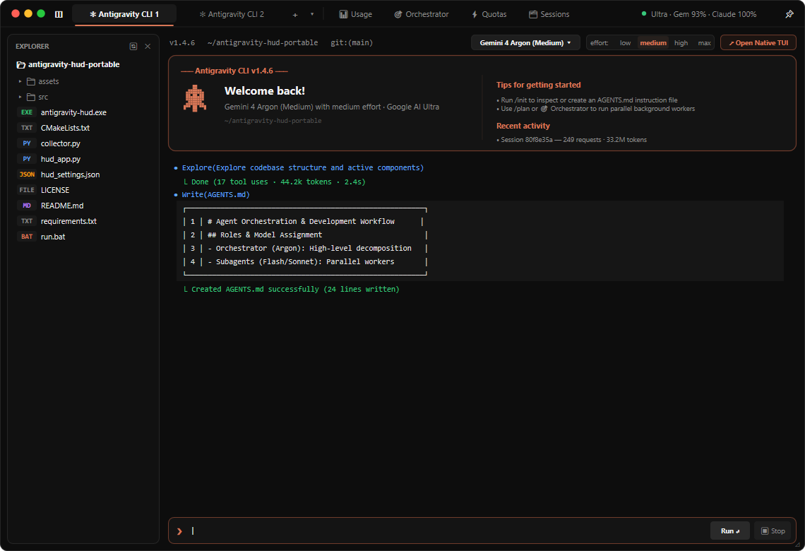
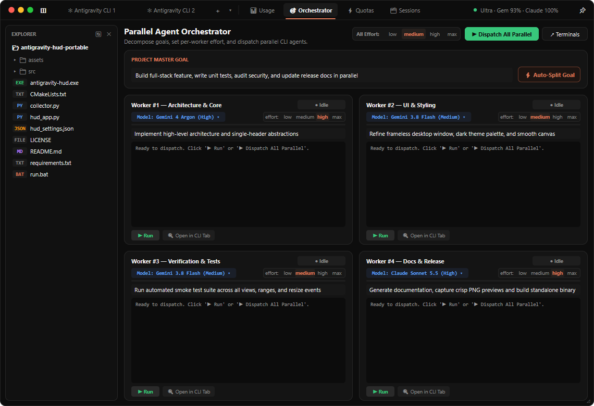
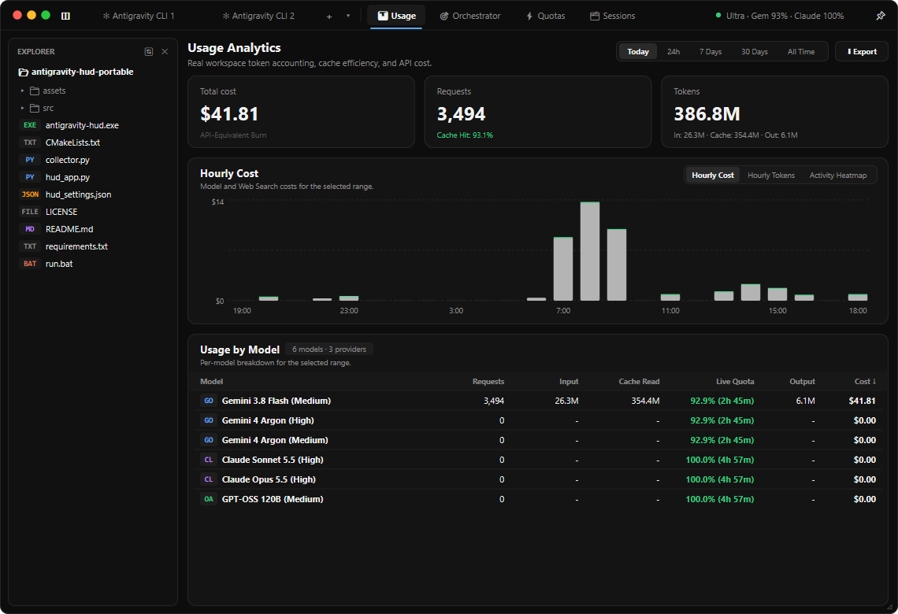
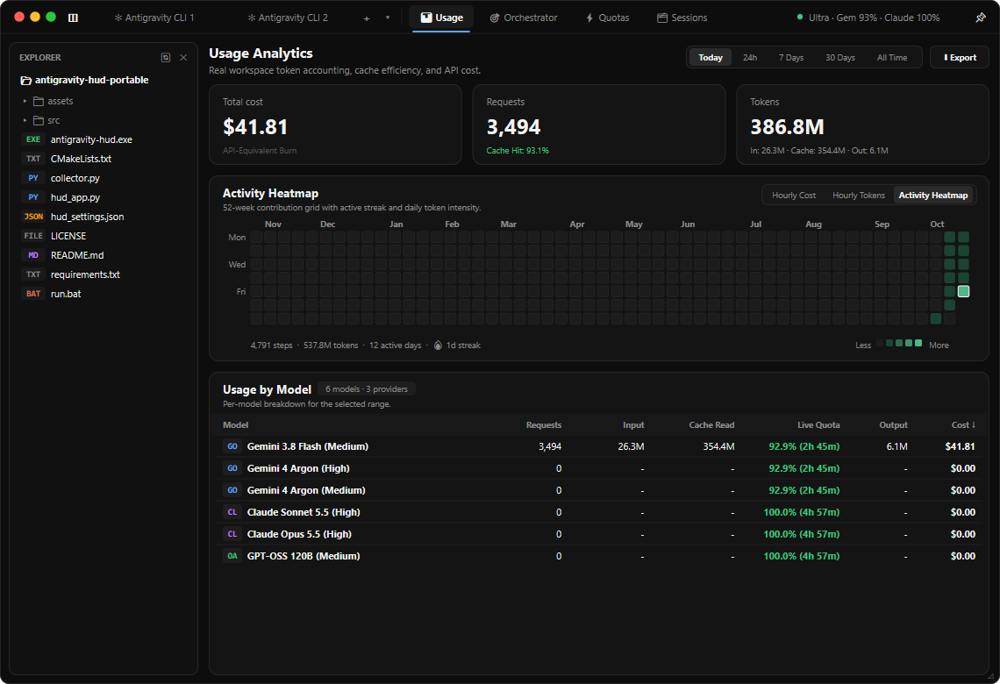
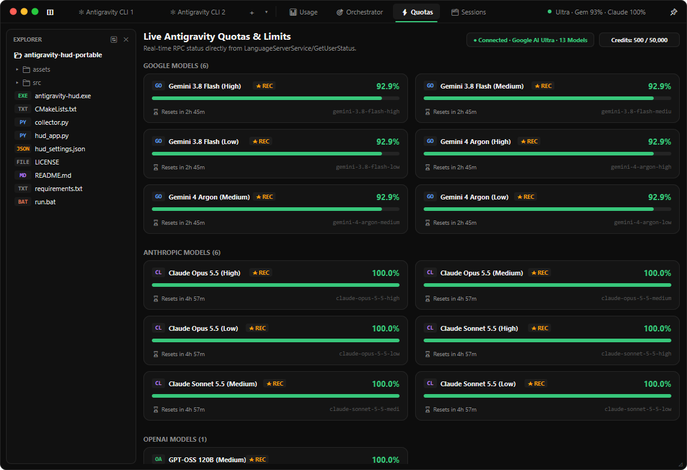

# Antigravity Usage Studio 🚀 (Native C++20 / Direct2D Edition)

A blazingly fast, zero-dependency **Native C++20 & Direct2D Desktop Application** for developers using **Google Antigravity**. Monitor real-time workspace token consumption, cache efficiency, API-equivalent costs, and live model quotas across Gemini, Claude, and OpenAI at a locked **60fps** with zero lag or flicker.


---

## 📸 Preview

### 1. Antigravity CLI Workspace & Terminal


### 2. Parallel Multi-Agent Orchestrator


### 3. Usage Analytics & Rolling Hourly Cost


### 4. 52-Week Full-Year Activity Heatmap Mode


### 5. Live Antigravity Language Server Quotas & Limits


---

## 🌟 Key Features

### 1. Claude Code Desktop / Cursor Studio Frameless Aesthetic
- **Frameless Desktop App**: Smooth Windows 11 DWM rounded corners, 1px `#262626` outer border, custom traffic lights (`🔴 🟡 🟢`), window drag/double-click maximize, and bottom-right resize grip (`◿`).
- **All-Round Card Architecture**: Every card, KPI box, terminal input, and button features smooth rounded corners (`RoundedCard`) with dark monochrome styling.
- **Taskbar Integration**: Cleanly integrates into the Windows taskbar with native minimize/restore and taskbar icon.
- **Collapsible File Explorer Sidebar**: Browse project workspace files with file extension badges (`PY`, `MD`, `JSON`, `BAT`, `EXE`, `TXT`).

### 2. Built-in Parallel Antigravity CLI Engine (`✻ Antigravity CLI`)
- **Multiple Parallel CLI Tabs**: Spawn concurrent `✻ Antigravity CLI N` tabs via the `+` button in the integrated title bar or open external native terminals (`↗`).
- **Interactive Effort & Model Selector**: Choose reasoning effort on the fly (`low` · `medium` · `high` · `max`) and switch models via the header dropdown (`▾`) or `/effort` slash command.
- **Signature Coral Welcome Card**: Features an animated 8-bit mascot creature (with subtle breathing & blinking), active model + effort badge, tips, and recent session telemetry.
- **Structured Terminal Stream**: Claude Code-style tool badges (`● Explore`, `● Write`, `● RunTests`) with syntax boxes and real-time `agy.exe` execution outputs.
- **Bottom Command Input**: Fast prompt entry bar with `Run ↵`, `⏹ Stop`, and slash commands (`/init`, `/plan`, `/effort`, `/models`, `/status`, `/clear`).

### 3. Parallel Multi-Agent Orchestrator (`🎯 Orchestrator`)
- **Global & Per-Worker Effort Control**: Switch all workers at once via `All Effort: [low] [medium] [high] [max]` or customize the model (`▾`) and effort (`low` · `medium` · `high` · `max`) individually on each worker card (with `Gemini 3.8 Flash (Medium)` configured as the fast coding default).
- **Master Goal Decomposition**: Enter high-level features and click `⚡ Auto-Split Goal` to distribute subtasks across concurrent agents.
- **2×2 Worker Grid with 60fps Progress Waves**: Concurrent execution cards for Architecture & Core, UI & Styling, Verification & Tests, and Docs & Release with live animated progress bars, status spinners, and console preview streams.
- **One-Click Dispatch**: Trigger all workers simultaneously with `▶ Dispatch All Parallel` or inspect any worker in a dedicated CLI tab.

### 4. 100% Real Token Accounting & Cost Engine
- **No approximations or fake step multipliers**: Tokens are calculated strictly using real execution telemetry:  
  $$\text{Total Tokens} = \text{Input Tokens} + \text{Cache Read Tokens} + \text{Output Tokens}$$
- **Real-time Cache Hit Percentage**:
  $$\text{Cache Hit \%} = \frac{\text{Cache Read Tokens}}{\text{Input Tokens} + \text{Cache Read Tokens}} \times 100$$
- **API-Equivalent Cost Engine**: Tracks cumulative cost burn based on official model family pricing per 1M tokens (Claude Opus / Sonnet, Gemini 4 Argon, Gemini 3.8 Flash, GPT-OSS).

### 5. Deep Studio Views
- 📊 **Usage Dashboard**:
  - **3 KPI Cards**: `Total cost`, `Requests`, and `Tokens` with breakdown metrics (`Cache Hit %`, `Input / Cache / Output`).
  - **Dual Chart Modes**: 24 rolling hourly buckets with interactive tooltips, or full 52-week activity contribution heatmap with streaks and intensity scales.
  - **Usage by Model Table**: Up to 8 active models with provider badges (`GO`, `CL`, `OA`), request counts, tokens, live quotas, and cost burn.
- ⚡ **Live Quotas View**:
  - Direct real-time RPC connection to the local Antigravity Language Server (`LanguageServerService/GetUserStatus`).
  - All 13 models tracked with live visual progress bars, remaining %, and countdown timers (e.g. `⏳ Resets in 1h 36m`).
- 🗂️ **Sessions View**:
  - Full table of recent workspace sessions (top 40) with real-time search filtering.

---

## 🚀 Quick Start

### Option 1: Standalone Native C++ Executable (1.5 MB — Zero Dependencies)
1. Download or locate `antigravity-hud.exe`.
2. Double-click **`antigravity-hud.exe`** to launch immediately (instant startup, hardware-accelerated 60fps Direct2D UI).

### Option 2: Build from C++20 Source (`g++` or `CMake`)
```powershell
g++ -std=c++20 -O3 -s -mwindows -Isrc src/main.cpp -o antigravity-hud.exe -ld2d1 -ldwrite -ldwmapi -lwindowscodecs -lwinhttp -liphlpapi -lws2_32 -lole32 -luuid -static
```
Or with CMake:
```powershell
cmake -B build -DCMAKE_BUILD_TYPE=Release
cmake --build build --config Release
```

### Option 3: Legacy Python Edition
```powershell
pip install -r requirements.txt
python hud_app.py
```

---

## 🔒 Privacy & Architecture

- **100% Local & Offline**: All telemetry is read directly from your local Antigravity directories (`~/.gemini/antigravity/brain` and `conversation_summaries.db`).
- **Zero Cloud Tracking**: No analytics, telemetry, or personal data are ever sent over the internet.
- **Local RPC**: Connects exclusively to the local loopback port (`127.0.0.1`) spawned by your local Antigravity process.

---

## 📄 License

Distributed under the [MIT License](LICENSE).
